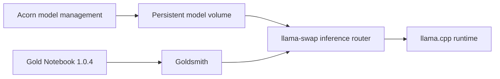

# Goldsmith architecture

Goldsmith is an agentic developer workstation, not an agent framework. It owns
the reproducible environment in which model runtimes and coding agents operate.

## Base-image contract

The initial release inherits Gold Notebook to avoid duplicating its workstation
stack. Goldsmith relies on the following interfaces:

- The `nonroot` user and `/home/nonroot` home directory
- Homebrew at `/home/linuxbrew/.linuxbrew`
- s6-overlay with `/init` as the entrypoint
- The `install_cuda_toolkit` and `cleanup` shell helpers
- code-server, Jupyter, Marimo, and Verdaccio services

The base version is passed through `NOTEBOOK_VERSION` and must be pinned for releases.
Compatibility with a newer base must be demonstrated by a successful image build
and runtime health check before changing the default.

## Ownership boundaries

Goldsmith owns container packaging, CUDA integration, inference service
supervision, runtime configuration, persistent model paths, and health checks.
Acorn owns model acquisition and generated model-router entries. Agent frameworks
and coding agents remain consumers installed or configured above this layer.

## Future decoupling

If Goldsmith no longer needs browser IDE and notebook services, it should rebase
onto a CUDA-capable runtime image. If Gold and Goldsmith continue sharing the full
workstation, their common layers should eventually move into a neutral foundation
image with an independently documented compatibility policy.
