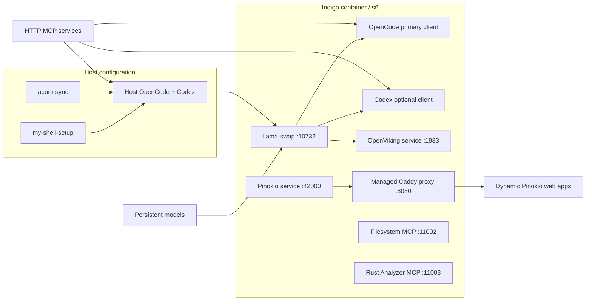

# Indigo architecture — Isolated Native Development Instance for Generative Operations

Indigo is an agentic developer environment rather than an agent framework. **Indigo = I**solated **N**ative **D**evelopment **I**nstance for **G**enerative **O**perations — local-first, agents-first, development-focused (formal verification lives in `gold`).
Its default path keeps model execution local while exposing standard APIs to
agents both inside and outside the Compose network.

## Operating modes

The published image and the full Compose deployment deliberately have different
defaults:

- A direct `docker run` enables inference and the base notebook services. The
  optional Indigo services remain dormant and are omitted from health checks.
- `docker compose up` enables all Indigo services and publishes their ports on
  host loopback. Workspace, model, and router-configuration directories are
  host-visible under `.indigo/` unless their paths are overridden.
- `compose.isolated.yaml` replaces those three bind mounts with Docker-managed
  volumes. `compose.cpu.yaml` removes the NVIDIA GPU reservation. The overrides
  are composable.

All modes use the same image. `INDIGO_ENABLE_INFERENCE`,
`INDIGO_ENABLE_FILESYSTEM`, `INDIGO_ENABLE_RUST_ANALYZER`,
`INDIGO_ENABLE_OPENVIKING`, and `INDIGO_ENABLE_PINOKIO` control the optional
service processes and their health obligations.

## Service boundaries

- `indigo` owns the workstation, local inference, agent defaults, shared
  workspace/model volumes, and the s6-supervised OpenViking, Pinokio,
  Filesystem MCP, and Rust Analyzer MCP services.
- `/etc/services.d/openviking` runs the pinned Python package and owns its
  configuration, context data, REST API, Studio, and MCP endpoint.
- `/etc/services.d/pinokio` runs the official headless backend at a pinned
  commit. Its managed Caddy process discovers app ports in the same container,
  including apps that bind only to loopback.
- MCP services use Streamable HTTP. Filesystem runs through a pinned
  Supergateway runtime, while Rust Analyzer uses the same gateway with a pinned
  MCP bridge and toolchain against the shared workspace. Formal verification
  (Lean) is provided by the standalone `mcp-lean` service in `jhwohlgemuth/gold`
  (`--profile formal`).

Indigo-local clients reach the integrated MCPs over container loopback. Host
clients use the same port numbers through Compose's published loopback ports.

Host configuration has two owners. `jhwohlgemuth/my-shell-setup` installs the
host tools and distributes base OpenCode/Codex configuration, including MCP
endpoints. `acorn sync` reconciles ACORN's model inventory into supported host
clients, with OpenCode as Indigo's primary target. Indigo provides
canonical host MCP templates but does not write host dotfiles. ACORN does not
currently configure Codex, so Codex remains owned by the shell setup plus its
Indigo MCP template.

On first start, Indigo renders its bundled `llama-swap` and OpenCode templates
from `INDIGO_DEFAULT_MODEL` and `INDIGO_DEFAULT_MODEL_PATH`. Existing files are
never replaced. This lets a direct image run have useful defaults while keeping
user- or ACORN-managed configuration authoritative.

## Base-image contract

The workstation builds on the explicitly versioned Gold Notebook image and
relies on:

- The `nonroot` user and `/home/nonroot` home directory
- Homebrew at `/home/linuxbrew/.linuxbrew`
- s6-overlay with `/init` as the entrypoint
- The `install_cuda_toolkit` and `cleanup` shell helpers
- code-server, Jupyter, Marimo, and Verdaccio services

`NOTEBOOK_VERSION` remains pinned. A newer base must pass an image build and
runtime health check before becoming the default.

## Inference build contract

llama.cpp is compiled from source with the CUDA backend so the image carries its
own GPU-capable `llama-server`. That build has two obligations beyond producing
the executables. The binaries are dynamically linked against `libllama`,
`libggml`, and `libggml-cuda`, so the shared objects are installed to
`/usr/local/lib` and that directory leads `LD_LIBRARY_PATH`. And because
`GGML_BACKEND_DL` is on, backends are discovered in the directory holding the
executable, so the backend objects are also installed to `/usr/local/bin`;
without them the server starts and then fails the first model load with `no
backends are loaded`. `scripts/build_llama_cpp_from_source.sh` verifies both at
build time, because a build that misses either still produces an image that
starts cleanly and only fails when `llama-swap` tries to serve a model. Router
liveness, for example `llama-swap`'s own `/health` response, is not evidence
that inference works; only a loaded model is.

## Networking and trust boundary

Published services bind to host loopback by default. Changing
`INDIGO_PUBLISH_HOST` widens the trust boundary for every listed port. MCP
servers and Pinokio scripts can perform powerful actions, so LAN or internet
exposure requires authentication, TLS, and per-service authorization outside
this development-oriented Compose stack.

Pinokio's proxy hides dynamic ports for HTTP/WebSocket apps; it does not turn
arbitrary TCP/UDP apps into HTTP. Indigo does not publish a general-purpose
dynamic port range, so exceptional non-HTTP services require an explicit port
mapping in the main Compose configuration.

Direct-image documentation follows the same loopback-only rule. The standalone
example publishes inference and the base notebook ports. Optional Indigo
services stay off unless the user opts in to both the service and its host port.

## Instance boundaries

`.env` is the single source of truth for the image tag, host publishing, and
instance identity. `compose.yaml` interpolates those values with `${VAR:?}`
and the Makefile defines no fallbacks, so a missing value fails at the Compose
and Make boundaries instead of producing an empty image reference or port.
`scripts/check.sh` owns the validation contract and runs in `make check`.
Optional behavior knobs are the exception: they keep the defaults baked into
`compose.yaml` and the image.

`scripts/new.sh` derives an instance file from `.env` by adding an
offset to each published port and assigning its own Compose project name,
container hostname, Pinokio domain, and host bind-mount paths under
`.indigo/<name>/`. Compose names the remaining volumes after the project
and the image is shared, so instances separate host ports and persistent state
without duplicating the container contract.

## Log surface contract

Long-running services log their startup state once and stay silent until that
state changes. Repeated polling is not part of the observable log surface. s6
restarts a longrun that exits, so a service that exits on a handled condition
turns into an unbounded log loop; the contract therefore requires services to
block rather than exit while they are waiting, and to bound their own retries
when the dependency they wait on is broken. OpenViking is the case in point: it
waits for `ov.conf` in-process, passes only flags the installed CLI accepts,
binds loopback so `dev` auth mode is usable, and retries a rejected
configuration on an interval instead of letting s6 restart it several times a
second. Default agent config must also be readable by `nonroot`, since
`/etc/indigo/defaults` is seeded by a root-owned one-shot at boot.

## Ownership boundaries

Indigo owns container packaging, CUDA integration, inference supervision,
service topology, persistent paths, container agent defaults, canonical host
MCP templates, and health contracts. [ACORN](https://acorn.ornl.gov) owns model
acquisition and generated OpenCode/model-router entries. The
[`my-shell-setup`](https://github.com/jhwohlgemuth/my-shell-setup) repository owns
host tool installation and base dotfile distribution. Agent frameworks and
coding agents consume these services.
