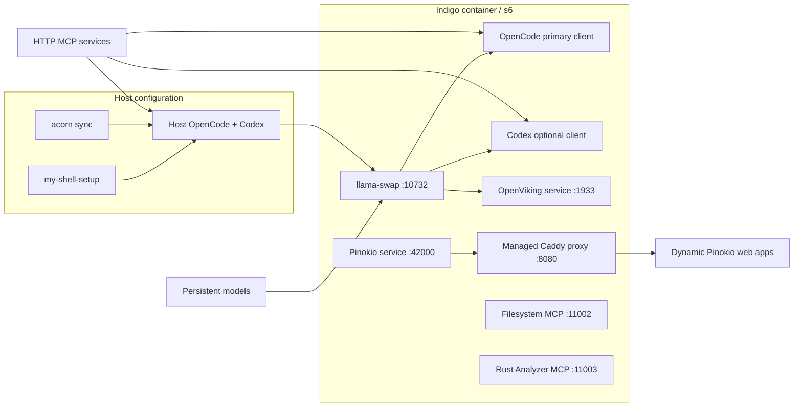

# Indigo architecture — Isolated Native Development Instance for Generative Operations

Indigo is an agentic developer environment rather than an agent framework. **Indigo = I**solated **N**ative **D**evelopment **I**nstance for **G**enerative **O**perations — local-first, agents-first, development-focused (formal verification lives in `gold`).
Its default path keeps model execution local while exposing standard APIs to
agents both inside and outside the Compose network.

## Service boundaries

- `indigo` owns the GPU workstation, local inference, agent defaults, shared
  workspace/model volumes, and the s6-supervised OpenViking, Pinokio,
  Filesystem MCP, and Rust Analyzer MCP services.
- `/etc/services.d/openviking` runs the pinned Python package and owns its
  configuration, context data, REST API, Studio, and MCP endpoint.
- `/etc/services.d/pinokio` runs the official headless backend at a pinned
  commit. Its managed Caddy process discovers app ports in the same container,
  including apps that bind only to loopback.
- MCP services use Streamable HTTP. Filesystem runs through a pinned
  Supergateway runtime, while Rust Analyzer uses the same gateway with a pinned
  MCP bridge and toolchain against the shared workspace. Formal verification
  (Lean) is provided by the standalone `mcp-lean` service in `jhwohlgemuth/gold`
  (`--profile formal`).

Indigo-local clients reach the integrated MCPs over container loopback. Host
clients use the same port numbers through Compose's published loopback ports.

Host configuration has two owners. `jhwohlgemuth/my-shell-setup` installs the
host tools and distributes base OpenCode/Codex configuration, including MCP
endpoints. `acorn sync` reconciles ACORN's model inventory into supported host
clients, with OpenCode as Indigo's primary target. Indigo provides
canonical host MCP templates but does not write host dotfiles. ACORN does not
currently configure Codex, so Codex remains owned by the shell setup plus its
Indigo MCP template.

## Base-image contract

The workstation builds on the explicitly versioned Gold Notebook image and
relies on:

- The `nonroot` user and `/home/nonroot` home directory
- Homebrew at `/home/linuxbrew/.linuxbrew`
- s6-overlay with `/init` as the entrypoint
- The `install_cuda_toolkit` and `cleanup` shell helpers
- code-server, Jupyter, Marimo, and Verdaccio services

`NOTEBOOK_VERSION` remains pinned. A newer base must pass an image build and
runtime health check before becoming the default.

## Networking and trust boundary

Published services bind to host loopback by default. Changing
`INDIGO_PUBLISH_HOST` widens the trust boundary for every listed port. MCP
servers and Pinokio scripts can perform powerful actions, so LAN or internet
exposure requires authentication, TLS, and per-service authorization outside
this development-oriented Compose stack.

Pinokio's proxy hides dynamic ports for HTTP/WebSocket apps; it does not turn
arbitrary TCP/UDP apps into HTTP. Indigo does not publish a general-purpose
dynamic port range, so exceptional non-HTTP services require an explicit port
mapping in the main Compose configuration.

## Ownership boundaries

Indigo owns container packaging, CUDA integration, inference supervision,
service topology, persistent paths, container agent defaults, canonical host
MCP templates, and health contracts. [ACORN](https://acorn.ornl.gov) owns model
acquisition and generated OpenCode/model-router entries. The
[`my-shell-setup`](https://github.com/jhwohlgemuth/my-shell-setup) repository owns
host tool installation and base dotfile distribution. Agent frameworks and
coding agents consume these services.
