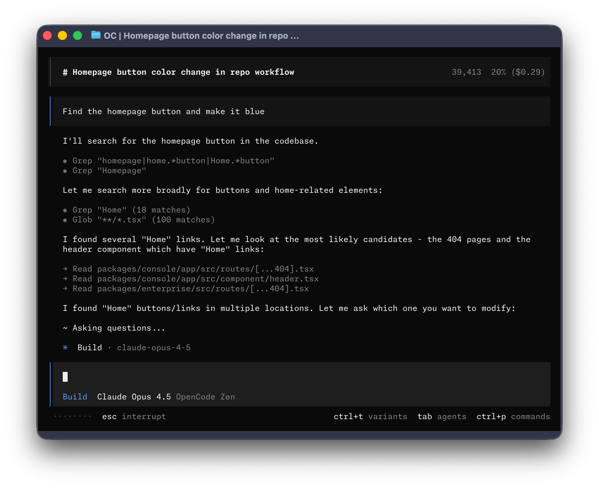
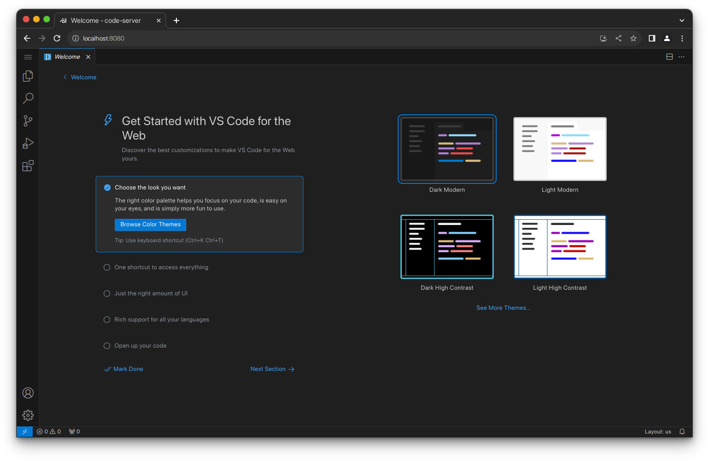
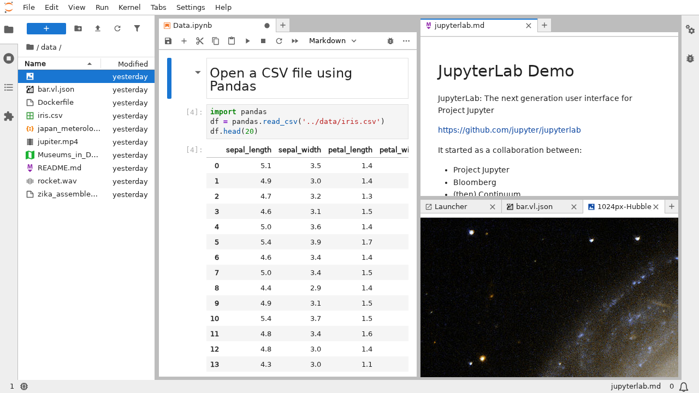
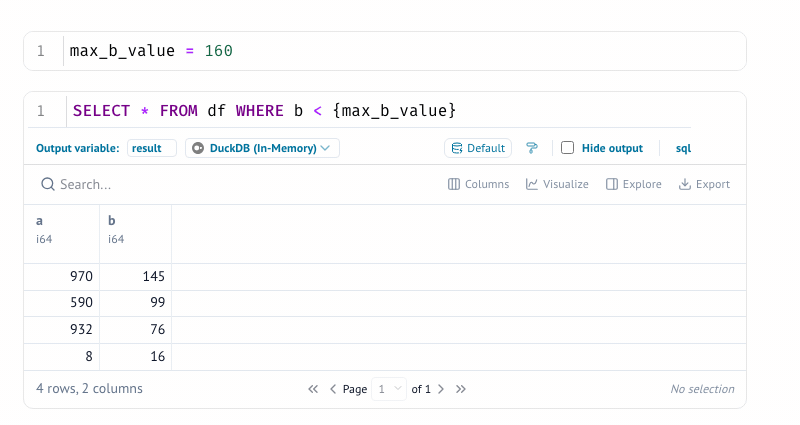
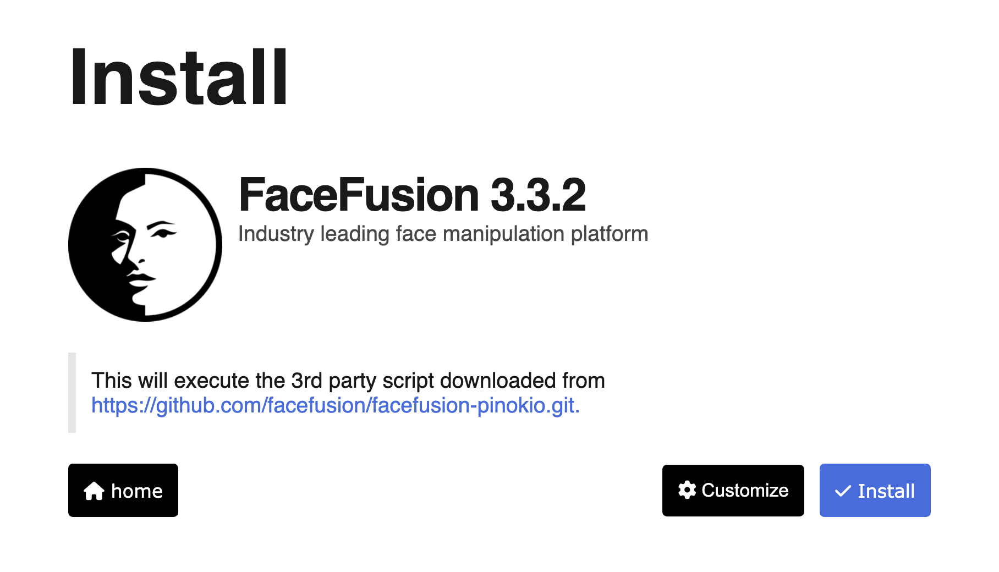
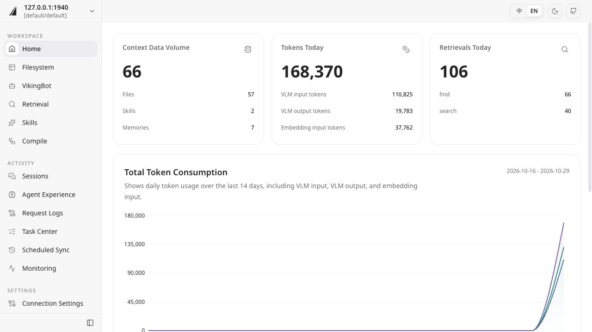

# Interface tour

INDIGO brings several upstream tools into one development environment. These
screenshots come from each project's official documentation or source
repository; they illustrate the interface, but may differ from INDIGO's pinned
version, selected theme, enabled services, or local configuration. They are not
runtime-validation evidence for the INDIGO image.

## OpenCode

OpenCode is INDIGO's primary agent client. The full-screen terminal interface
shows the conversation, tool activity, selected model, and current agent mode.
INDIGO seeds its local endpoint and default model only when OpenCode has no
existing user configuration.

<figure class="interface-screenshot">
  
  <figcaption>Upstream screenshot from the <a href="https://opencode.ai/docs">OpenCode documentation</a>.</figcaption>
</figure>

## code-server

code-server provides the browser IDE at `https://127.0.0.1:1337` by default.
It exposes a VS Code workbench backed by the persistent INDIGO development
environment.

<figure class="interface-screenshot">
  
  <figcaption>Upstream screenshot from the <a href="https://github.com/coder/code-server/blob/main/docs/assets/screenshot-1.png">code-server repository</a>.</figcaption>
</figure>

## JupyterLab

JupyterLab is available on port `13337` by default. Its workspace combines
notebooks, terminals, text files, rich output, and a file browser in one
multi-panel interface.

<figure class="interface-screenshot">
  
  <figcaption>Upstream screenshot from the <a href="https://jupyterlab.readthedocs.io/en/stable/user/interface.html">JupyterLab interface documentation</a>.</figcaption>
</figure>

## Marimo

Marimo is available on port `13338` by default. It provides reactive Python and
SQL notebooks whose dependent cells update together and whose source remains
plain Python.

<figure class="interface-screenshot">
  
  <figcaption>Upstream screenshot from the <a href="https://docs.marimo.io/">Marimo documentation</a>.</figcaption>
</figure>

## Pinokio

When enabled, Pinokio's management interface is published on port `42000`.
It presents installation and launch workflows for scripts and displays the
upstream repository before a third-party script runs.

<figure class="interface-screenshot">
  
  <figcaption>Upstream screenshot from the <a href="https://github.com/pinokiocomputer/pinokio">Pinokio repository</a>.</figcaption>
</figure>

## OpenViking Studio

OpenViking Studio provides context-resource browsing, retrieval, sessions, and
operational views. INDIGO keeps OpenViking container-local by default; its
Studio is therefore not a host-access promise unless an authenticated,
network-facing configuration is added deliberately.

<figure class="interface-screenshot">
  
  <figcaption>Upstream screenshot from the <a href="https://github.com/volcengine/OpenViking/blob/main/docs/images/quickstart/studio/home-en.jpg">OpenViking repository</a>.</figcaption>
</figure>
